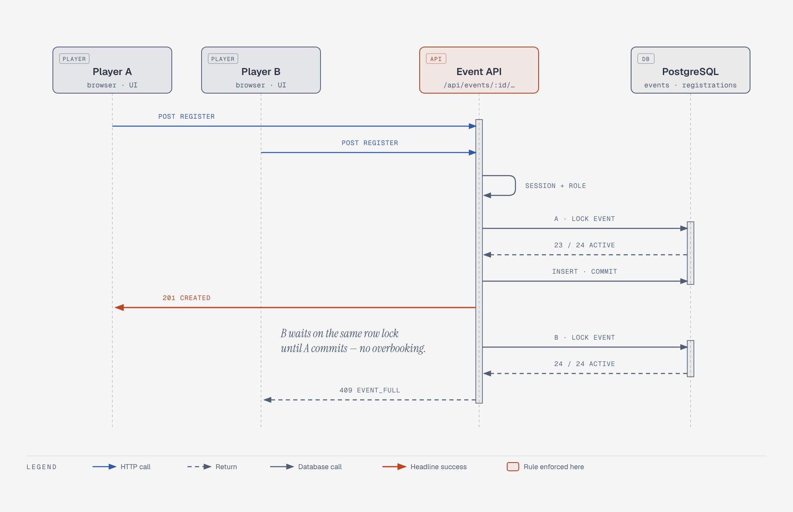
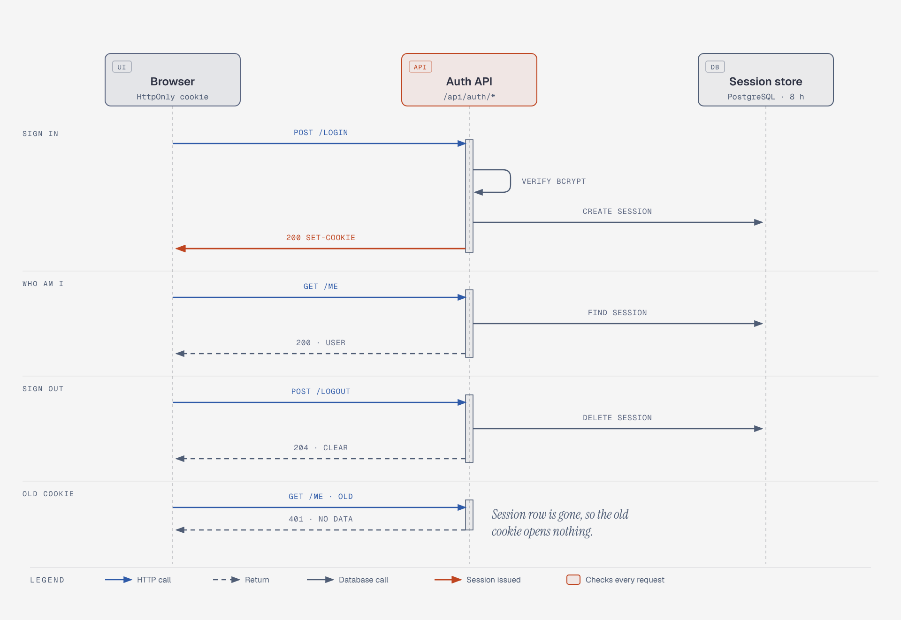
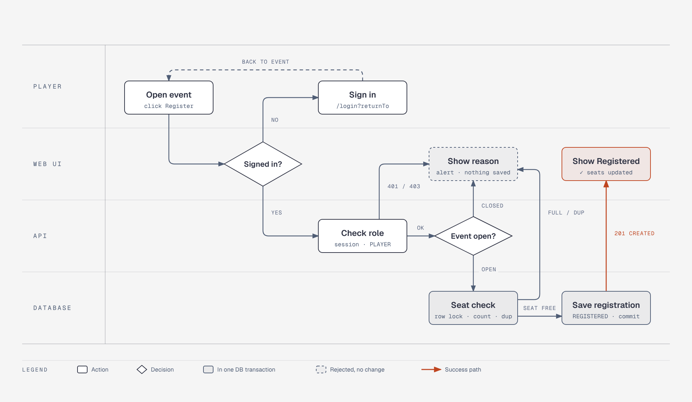
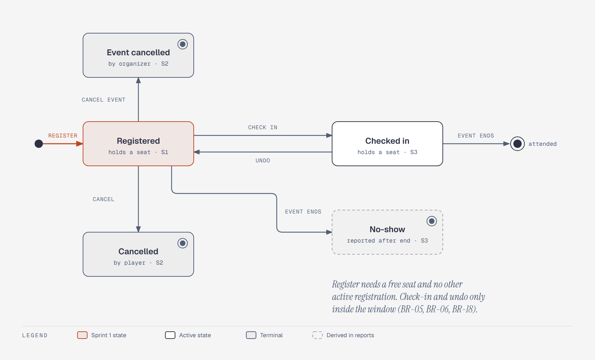
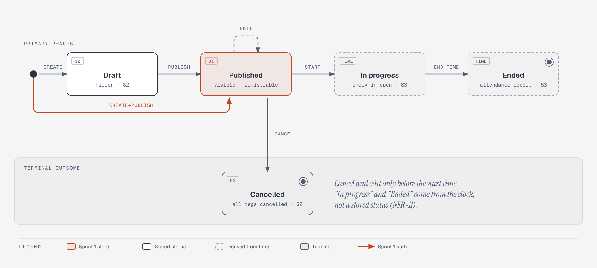

# Behaviour diagrams

Version v0.1 (4 Nov 2026) · Branch `sprint-1/spec`

These diagrams show how the product behaves, using the requirement IDs from [`docs/srs.md`](../srs.md). Each one has
an `.html` source (open it in a browser; the drawing is SVG, so it stays sharp at any zoom) and a `.png` export for
the PDF and for this page. They were drawn with the
[diagram-design](https://github.com/cathrynlavery/diagram-design) skill in its default style.

To change a diagram, edit `build.py`, run `python3 docs/diagrams/build.py`, and export the PNG again with the skill's
`scripts/export_png.py <file.html> <file.png> 2`.

| # | Diagram | Kind | Shows | Requirements |
|---|---|---|---|---|
| D1 | [Two players, one last seat](#d1-sequence--two-players-one-last-seat) | Sequence | How the server stops two people taking the same last seat | FR-15, BR-05, BR-06, BR-07, NFR-05 |
| D2 | [Sign in, who am I, sign out](#d2-sequence--sign-in-who-am-i-sign-out) | Sequence | The life of a login session, and why an old cookie stops working | FR-01–FR-04, NFR-01, NFR-03, NFR-04 |
| D3 | [Registering for an event](#d3-activity--registering-for-an-event) | Activity (swimlane) | Every check a registration passes, and who does each one | FR-15, FR-16, FR-26, BR-04–BR-07, BR-10, BR-17 |
| D4 | [Life of a registration](#d4-state-machine--life-of-a-registration) | State machine | Every status a registration can have and what moves it | BR-05–BR-12, BR-18–BR-20 |
| D5 | [Life of an event](#d5-state-machine--life-of-an-event) | State machine | Every status an event can have, stored or worked out from the clock | FR-06, FR-08–FR-10, BR-04, BR-15 |

---

## D1. Sequence — two players, one last seat

Source: [`seq-register.html`](seq-register.html)

**How to read it.** Time runs from top to bottom. Each box at the top is a participant. Each arrow is one message.

1. Player A and Player B both press **Register** for an event that has 23 of 24 seats taken.
2. The API first checks each request's session and role (BR-17, BR-10).
3. For A, the API **locks the event row** in the database, counts 23 active registrations, saves A's registration
   and commits. A receives **201 Created**.
4. B's request was waiting on the same lock. When the lock is released, B's count is 24 of 24, so B receives
   **409 EVENT_FULL** and nothing is saved.

This is how BR-07 ("exactly one person gets the last seat") and NFR-05 (the 20-request concurrency test) are met.
Duplicate registrations are also stopped by a unique rule in the database (BR-06), even if the same player
double-clicks.

---

## D2. Sequence — sign in, who am I, sign out

Source: [`seq-auth.html`](seq-auth.html)

| Step | What happens | Requirement |
|---|---|---|
| Sign in | The browser sends email and password. The API compares the password with the stored **bcrypt** hash, creates a session row, and returns an **HttpOnly** cookie that page scripts cannot read | FR-01, NFR-03, NFR-04 |
| Who am I | Each request carries the cookie. The API finds the session and returns the user's id, name and role | FR-03 |
| Sign out | The API **deletes** the session row and tells the browser to clear the cookie | FR-04 |
| Old cookie | A request that reuses the old cookie finds no session, so it gets **401** and no data | NFR-01, NFR-04 |

A wrong password is not drawn here. It returns 401 with one generic message (FR-02) and creates no session.

---

## D3. Activity — registering for an event

Source: [`activity-register.html`](activity-register.html)

Each horizontal band (lane) belongs to one participant: the player, the web UI, the API, or the database.

- **Signed in?** The UI sends a visitor to sign in, then back to the same event (FR-26).
- **Check role.** The API rejects a missing session with **401** and an organizer with **403** (BR-10, BR-17).
  The UI's hidden button is not trusted.
- **Event open?** The event must be published and not yet started (BR-04). Otherwise **409 closed**.
- **Seat check.** Inside one database transaction holding the row lock, the API counts active seats and looks for an
  existing active registration (BR-05, BR-06, BR-07). Otherwise **409 full** or **409 duplicate**.
- **Save registration.** A `REGISTERED` record is committed and the UI shows **✓ Registered** with the new seat
  count.

Every rejection ends in the same "Show reason" box: the UI shows the server's message and nothing is saved.

---

## D4. State machine — life of a registration

Source: [`state-registration.html`](state-registration.html)

| From | Event | To | Rule | Sprint |
|---|---|---|---|---|
| (start) | Player registers | Registered | Free seat and no other active registration (BR-05, BR-06) | 1 |
| Registered | Player cancels | Cancelled | Only own, before the deadline (BR-11) | 2 |
| Registered | Organizer cancels the event | Event cancelled | All active registrations (BR-12) | 2 |
| Registered | Organizer checks the player in | Checked in | Owner only, inside the check-in window (BR-18) | 3 |
| Checked in | Organizer undoes the check-in | Registered | Inside the window (BR-19) | 3 |
| Registered | Event ends | No-show *(reported)* | Worked out in reports, not stored (BR-20) | 3 |
| Checked in | Event ends | (attended) | Counts as attended in the report | 3 |

*Registered* and *Checked in* each hold a seat, so together they make up the "active registrations" that BR-05
counts. A cancelled player may register again as a **new** record (FR-20).

---

## D5. State machine — life of an event

Source: [`state-event.html`](state-event.html)

- **Sprint 1** has one path: the organizer creates an event and publishes it in one step (decision D-06). That path
  is highlighted.
- **Draft** (Sprint 2) is a stored status that participants cannot see (FR-08).
- **Edit** and **Cancel** are allowed only before the start time (BR-15, FR-10).
- **In progress** and **Ended** are **not stored**. The server works them out by comparing the start and end times
  with its own clock (NFR-11). That is why they have dashed borders.

---

## Change log

| Version | Date | Change |
|---|---|---|
| v0.1 | 4 Nov 2026 | D1–D5 first versions |
