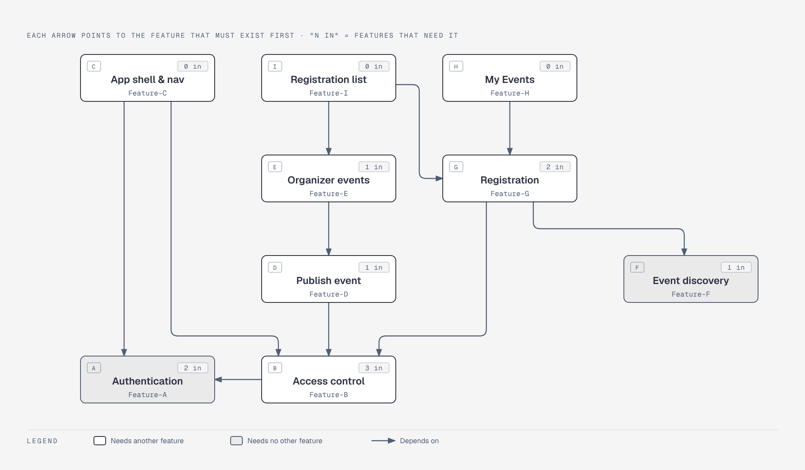

# Complete Feature Inventory

Project: **TCG Event Hub** — Event Registration and Attendance System
Document version: v0.1 — draft for team review (branch `sprint-1/spec`)
Source of requirements: [`docs/srs.md`](srs.md) v0.3 · Next document: `docs/traceability.md`

This is step 2 of the course design process. The whole product is split into **features**: pieces small enough to
specify, build, test and review on their own, yet large enough to give a user something they can see. Each feature
has a stable ID (`Feature-A` … `Feature-S`) that never changes meaning. A withdrawn feature keeps its ID and is
marked *Withdrawn*.

Some requirements belong to **no single screen**, such as the database, the error format, or deployment. They are
listed as **system responsibilities** (`SR-01` … `SR-07`). Each one names the sprint that **establishes** it and the
sprints that **re-verify** it.

How the pieces connect:

```
  SRS requirement (FR / BR / NFR)  ──►  Feature or SR  ──►  Sprint  ──►  Feature contract: AC + tests (Sprint docs)
        "what must be true"            "which piece"        "when"          "how we prove it"
```

---

## 1. Features

| ID | Feature | Feature scope | Sprint |
|---|---|---|---|
| **Feature-A** | User Authentication and Session | Sign-in with email and password for seeded accounts, one generic error for bad credentials, password hashing, server-side session cookie with 8-hour expiry, current-user retrieval, and sign-out that invalidates the session. | 1 |
| **Feature-B** | Role and Ownership Access Control | Backend enforcement of the two roles (Participant, Organizer) and of record ownership: role guards (403), ownership checks that hide other users' records (404), and identity taken only from the session, never from the client. | 1 |
| **Feature-C** | Application Shell and Role Navigation | Header with account menu (display name, role badge, sign-out), navigation per role, protected routes, sign-in-then-return to the original page, "Not available" and "Not found" pages, and the shared loading, empty, error and form-validation states in the Arcane Ink theme. | 1 |
| **Feature-D** | Event Creation and Publication | Organizer form to create and publish an event (title, type, format, venue, address, city, start/end, capacity, fee label, structure note, contact, description), server validation of every field, and recording of the organizer as owner. | 1 |
| **Feature-E** | Organizer Event Dashboard | The organizer's list of their own events with status, capacity, active registrations and seats remaining, and links to each event's registrations. | 1 |
| **Feature-F** | Event Discovery List and Detail | Public list of upcoming published events as cards (date badge, time, title, type · format, venue, fee chip, seats chip) ordered by start time, and the detail page with all public fields and a server-decided action button state. | 1 |
| **Feature-G** | Event Registration | A participant registers for a published, upcoming event, with the capacity rule, one active registration per participant per event, and a single winner for the last seat under simultaneous requests; rejections give a specific reason and store nothing. | 1 |
| **Feature-H** | My Events (Participant Registrations) | The participant's own registrations with event, date/time, venue and status, and no access to anyone else's. | 1 |
| **Feature-I** | Event Registration List | The owning organizer's list of registrations for one event (participant name, registration time, status, count vs capacity); other organizers and all participants are refused. | 1 |
| **Feature-J** | Event Search and Filters | Text search (title, venue, city) and filters for event type, format, date range and "seats available only"; past and cancelled events shown only when explicitly requested and never registrable. | 2 |
| **Feature-K** | Draft Events | Saving an event as a draft that only its owner can see, and publishing it later. | 2 |
| **Feature-L** | Event Editing and Capacity Change | The owner edits event details; capacity may rise at any time before start and fall only to the current active count; start time, capacity and deadline are frozen once the event starts. | 2 |
| **Feature-M** | Registration Deadline | A per-event registration deadline (default = start time, never later), enforced for registration and participant cancellation. | 2 |
| **Feature-N** | Registration Cancellation and Re-registration | A participant cancels their own active registration before the deadline, freeing the seat, and may register again later as a new record. | 2 |
| **Feature-O** | Event Cancellation | The owner cancels an upcoming event with a reason; all active registrations become `EVENT_CANCELLED` and the event stops accepting registrations, permanently. | 2 |
| **Feature-P** | Check-in and Undo | The owner checks in registered participants during the check-in window (60 min before start to end), records who and when, and can undo a mistaken check-in in the same window. | 3 |
| **Feature-Q** | Event Attendance Report | Per-event report: capacity, registrations, cancellations, checked-in, no-shows and attendance rate, with "—" when no rate can be calculated. | 3 |
| **Feature-R** | Organizer Attendance Summary | Summary across the organizer's events in a chosen date range: number of events, registrations, check-ins, average fill rate and attendance rate, within the performance target. | 3 |
| **Feature-S** | Participant Event History | The participant's past events with final status: attended, no-show, cancelled or event cancelled. | 3 |

## 2. System responsibilities (cross-cutting)

| ID | Responsibility | Scope | Established | Re-verified |
|---|---|---|---|---|
| **SR-01** | Persistence, Migrations and Seed Data | PostgreSQL schema created only by versioned migrations; database constraints that back the rules (unique active registration, capacity check); idempotent seed with demo organizers, participants and events; data survives restart. | 1 | 2, 3, Lab 5 |
| **SR-02** | API Conventions and Safe Errors | One JSON error shape `{ error: { code, message, details? } }`, field-level validation details, consistent status codes (400/401/403/404/409/422), no stack traces or other users' data in any response. | 1 | 2, 3 |
| **SR-03** | Time Handling | UTC storage, Asia/Bangkok display, and every "upcoming", deadline and check-in decision made with the server clock; clock injectable in tests. | 1 | 2, 3 |
| **SR-04** | Configuration, Secrets and Deployability | Environment-variable configuration with `.env.example`, no secrets in Git or client code, design suitable for Docker and GCP; actual container, CI/CD and deployment in Lab 5. | 1 (design) | Lab 5 |
| **SR-05** | Responsive Layout and Accessibility | 390 / 768 / 1440 px without horizontal scroll for each sprint's screens; keyboard use, visible labels, 4.5:1 contrast and a zero-serious-issue accessibility scan for the whole product. | 1 (layout) | 3 (full) |
| **SR-06** | Performance | Event list and organizer report under 500 ms (95th percentile) with 500 events and 5,000 registrations seeded. | 3 | — |
| **SR-07** | Verification and Traceability | Every acceptance criterion linked to an automated test or a justified manual check; every BR has a negative test; traceability reviewed at each release. | 1 | 2, 3 |

## 3. Requirements and dependencies per feature

"Depends on" means the other feature or responsibility must exist first.

| ID | Functional requirements | Business rules | Non-functional | Depends on |
|---|---|---|---|---|
| Feature-A | FR-01, FR-02, FR-03, FR-04 | — | NFR-01, NFR-03, NFR-04 | SR-01, SR-02 |
| Feature-B | — | BR-10 (role part), BR-13, BR-14, BR-16, BR-17 | NFR-01, NFR-02 | Feature-A |
| Feature-C | FR-05, FR-26, FR-27 | — | NFR-08, NFR-09 | Feature-A, Feature-B |
| Feature-D | FR-06 | BR-01, BR-02, BR-03, BR-13 | NFR-07, NFR-11 | Feature-B, SR-01, SR-03 |
| Feature-E | FR-07 | BR-14 | NFR-02 | Feature-D |
| Feature-F | FR-11, FR-12 | BR-04, BR-16 (public sees counts only) | NFR-08, NFR-11 | SR-01, SR-03 |
| Feature-G | FR-15, FR-16 | BR-04, BR-05, BR-06, BR-07, BR-10 | NFR-05, NFR-07 | Feature-B, Feature-F, SR-01 |
| Feature-H | FR-17 | BR-16 | NFR-02, NFR-09 | Feature-G |
| Feature-I | FR-18 | BR-14, BR-16 | NFR-02 | Feature-E, Feature-G |
| Feature-J | FR-13, FR-14 | BR-04 | NFR-12 | Feature-F |
| Feature-K | FR-08 | BR-04, BR-13 | NFR-02 | Feature-D |
| Feature-L | FR-09 | BR-09, BR-15 | NFR-11 | Feature-D, Feature-G |
| Feature-M | FR-09 (deadline field) | BR-08 | NFR-11 | Feature-L, Feature-G |
| Feature-N | FR-19, FR-20 | BR-06, BR-11 | NFR-05 | Feature-G, Feature-M |
| Feature-O | FR-10 | BR-12, BR-15 | NFR-02 | Feature-D, Feature-G |
| Feature-P | FR-21, FR-22 | BR-18, BR-19 | NFR-11 | Feature-I |
| Feature-Q | FR-23 | BR-20 | NFR-10 | Feature-P |
| Feature-R | FR-24 | BR-20 | NFR-12 | Feature-Q |
| Feature-S | FR-25 | BR-20 | NFR-02 | Feature-H, Feature-P |
| SR-01 | — | BR-05, BR-06 (database constraints) | NFR-06 | — |
| SR-02 | FR-16 (error reasons) | — | NFR-07 | — |
| SR-03 | — | BR-02, BR-08, BR-18 (time boundaries) | NFR-11 | — |
| SR-04 | — | — | NFR-13 | — |
| SR-05 | — | — | NFR-08, NFR-10 | Feature-C |
| SR-06 | — | — | NFR-12 | Feature-J, Feature-R |
| SR-07 | — | — | NFR-14 | — |

## 4. Coverage check

Every SRS requirement must belong to at least one feature or responsibility. Checked against SRS v0.3:

| Group | IDs in the SRS | Covered | Not covered |
|---|---|---|---|
| Functional requirements | FR-01 … FR-27 | 27 / 27 | none |
| Business rules | BR-01 … BR-20 | 20 / 20 | none |
| Non-functional requirements | NFR-01 … NFR-14 | 14 / 14 | none |

Requirements shared by several features, such as BR-04, BR-16 and NFR-02, are **established** by the first feature
listed in the sprint plan and **re-tested** by each later feature that relies on them. The traceability matrix
(`docs/traceability.md`) gives each one a single "established in" sprint.

## 5. Sprint 1 feature bundle (preview of step 5)

Sprint 1 must deliver a thin, complete slice: sign in, publish, find, register, and see the result, with real
permissions. That slice needs **Feature-A to Feature-I** plus **SR-01, SR-02 and SR-03**, with SR-04, SR-05 and
SR-07 established at their Sprint 1 level.



Source: [`diagrams/dep-sprint1.html`](diagrams/dep-sprint1.html). Every arrow points to the feature that must exist
first. *Access control* (Feature-B) is needed by three features, so it is built straight after authentication.
*Event discovery* (Feature-F) needs no other feature, so it can be built in parallel. SR-01 (database) sits under
everything and is not drawn.

A suggested build order for the two of us. Each row becomes one or more GitHub Issues, each on its own branch from
`sprint-1-staging`:

| Order | Student 1 | Student 2 | Why this order |
|---|---|---|---|
| 1 | SR-01 schema, migrations, seed · SR-02 error format | SR-03 clock helper · client project and Feature-C shell skeleton | Everything else needs the database and the error format |
| 2 | Feature-A sign-in, session, sign-out | Feature-F event list and detail (read-only, seeded events) | Feature-F needs no login, so both can work at once |
| 3 | Feature-B role and ownership guards | Feature-D create and publish | Feature-D needs Feature-B's organizer guard |
| 4 | Feature-G registration (rules + concurrency) | Feature-E organizer dashboard | Feature-G is the riskiest rule work, so it gets the most time |
| 5 | Feature-H My Events | Feature-I registration list | Both read what Feature-G writes |
| 6 | Integration on staging, E2E journeys, evidence | Integration on staging, E2E journeys, evidence | Step 10 of the process |

Both students review each other's Pull Requests, so each student reads and approves the other half of the system.

---

## 6. Change log

| Version | Date | Change | Author |
|---|---|---|---|
| v0.1 | 4 Nov 2026 | First complete inventory: Feature-A … Feature-S, SR-01 … SR-07, coverage check, Sprint 1 bundle and dependency graph | Team (AI-assisted) |
