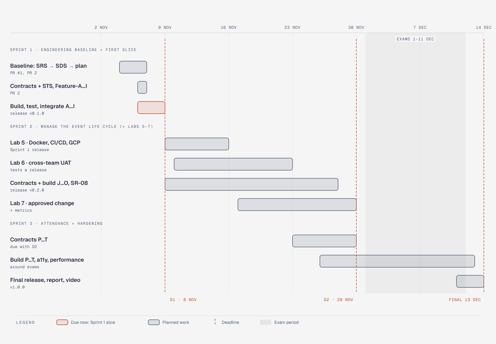

# Three-Sprint Plan

Project: **TCG Event Hub** · Document version: v0.1 — draft for team review (PR 2)
Inputs: [`../features.md`](../features.md) v0.2 · [`../traceability.md`](../traceability.md) v0.2 ·
[`../system-sds.md`](../system-sds.md) v0.2 · Course schedule: group work specification §4, §7, §10

This is step 5 of the course design process. It decides **which features are built in which sprint**, in what
order, and what "done" looks like at the end of each sprint. Together the three sprints cover the whole baseline:
all 20 features (Feature-A … Feature-T), all 8 system responsibilities (SR-01 … SR-08) and all 64 requirements.

Source: [`../diagrams/gantt-sprints.html`](../diagrams/gantt-sprints.html)

---

## 1. Overview

| Sprint | Dates | Goal (one sentence) | Features | Requirements established | Checkpoint |
|---|---|---|---|---|---|
| **1** | 4–8 Nov | A player can sign in, find an event, take a seat that can never be double-booked, and see it; an organizer can publish an event and see who registered, all with real server-side permissions | A, B, C, D, E, F, G, H, I + SR-01, SR-02, SR-03 (SR-04, SR-05, SR-07 at Sprint 1 level) | 40 (15 FR, 12 BR, 13 NFR) | **Deliverable 1**, 8 Nov: release `v0.1.0` on `main` |
| **2** | 9–29 Nov | Organizers manage the whole life of an event (draft, edit, capacity, deadline, cancel) and players can change their minds, with a record of who changed what | J, K, L, M, N, O + SR-08 | 13 (8 FR, 5 BR) | **Deliverable 2**, 29 Nov: release `v0.2.0`, deployed; Sprint 3 contracts and progress |
| **3** | 23 Nov – 13 Dec | Organizers check players in and see attendance; players see their history; the product is hardened for accessibility, performance and sign-in abuse | P, Q, R, S, T + SR-05 (full), SR-06 | 11 (5 FR, 3 BR, 3 NFR) | Progress at 29 Nov; **Final delivery**, 13 Dec: release `v1.0.0` + video |

The course labs run on the same application. They are **not** feature work, and their evidence is kept separate
(group spec §8.3):

| Lab | Due | Uses | Adds to the product |
|---|---|---|---|
| Lab 5: CI/CD, Docker, GCP | 15 Nov | Sprint 1 release `v0.1.0` | Completes SR-04: Dockerfile, CI quality gate, Cloud Run + Cloud SQL (SDS §9.3) |
| Lab 6: cross-team UAT | 22 Nov | A recorded release (`v0.1.x`) | Defect fixes through Issue → test → fix → PR → re-test |
| Lab 7: maintenance and metrics | 29 Nov | Released behaviour (TA-approved change) | One changed rule, with its contract revision and regression tests |

---

## 2. Sprint 1: engineering baseline and first working slice (4–8 Nov)

### 2.1 Why this is the Sprint 1 scope

The theme's Sprint 1 example (group spec §6, Theme 3) sets the **minimum** depth. Each sentence of the example maps
onto our features:

| Theme 3 Sprint 1 example says | Our feature | Requirements |
|---|---|---|
| "An organizer logs in" / "a participant logs in" | Feature-A sign-in, Feature-C shell | FR-01–FR-05, FR-26, FR-27 |
| "…and publishes an event with a positive capacity" | Feature-D create and publish | FR-06, BR-01–BR-03, BR-13 |
| (finding the event to register for) | Feature-F list and detail | FR-11, FR-12, BR-04 |
| "registers, and views their registration" | Feature-G registration, Feature-H My Events | FR-15–FR-17 |
| "The organizer views the event's registrations" | Feature-E dashboard, Feature-I registration list | FR-07, FR-18 |
| "Enforce capacity and one active registration per participant per event, including competing requests for the last place" | Feature-G rules + SDS §4.4 seat lock | BR-05, BR-06, BR-07, NFR-05 |
| "Participants cannot publish events or inspect another participant's private registration. Organizers manage their own events" | Feature-B role and ownership control | BR-10, BR-13, BR-14, BR-16, BR-17, NFR-01, NFR-02 |
| "Test both role and ownership restrictions" | AC-B-03 permission matrix + AC-E-02, AC-H-02, AC-I-02/03 | NFR-02, NFR-14 |

Deliverable 1 §2 adds **real login, logout and current-user identity** (Feature-A), **automated tests for rules,
persistence and access** (SR-07), and **GitHub Issues, feature branches, reviewed PRs, staging and a release on
`main`**. The cross-cutting responsibilities each feature needs from day one are therefore in Sprint 1 too: the
database and seed (SR-01), the error and validation conventions (SR-02), and the server clock (SR-03).

So Sprint 1 is the **thinnest slice that still runs through every layer**. A player's seat goes from the UI, through
the API's guards, into a locked database transaction, and back out to My Events and the organizer's list.

### 2.2 In scope

| ID | Feature / responsibility | Sprint 1 level | ACs |
|---|---|---|---|
| Feature-A | User Authentication and Session | Full | AC-A-01 … 06 |
| Feature-B | Role and Ownership Access Control | Full, for every Sprint 1 endpoint (E-01 … E-12) | AC-B-01 … 03 |
| Feature-C | Application Shell and Role Navigation | Full for Sprint 1 screens | AC-C-01 … 06 |
| Feature-D | Event Creation and Publication | Create = publish (D-06); no drafts or edits | AC-D-01 … 05 |
| Feature-E | Organizer Event Dashboard | Own events with counts | AC-E-01, 02 |
| Feature-F | Event Discovery List and Detail | Upcoming list + detail; search bar shown but inactive | AC-F-01 … 05 |
| Feature-G | Event Registration | Full rules incl. last-seat race | AC-G-01 … 06 |
| Feature-H | My Events | Own registrations | AC-H-01, 02 |
| Feature-I | Event Registration List | Owner only, display names | AC-I-01 … 03 |
| SR-01 | Persistence, migrations, seed | First migration with constraints (SDS §4.3), idempotent seed | AC-SR1-01, 02 |
| SR-02 | API conventions, validation, errors | zod `.strict()`, error shape, check order, no GET writes | AC-SR2-01 … 03 |
| SR-03 | Time handling | `clock.ts`, UTC, Bangkok display | AC-SR3-01 |
| SR-04 | Configuration and deployability | `.env.example`, start-up config check, `/api/health`, secret scan. **Docker and GCP are Lab 5** | AC-SR4-01 |
| SR-05 | Responsive layout | Sprint 1 screens at 390 / 768 / 1440 px. **Accessibility scan is Sprint 3** | AC-SR5-01 |
| SR-07 | Verification and traceability | Every Sprint 1 AC tested; results table at release | AC-SR7-01 |

**Totals:** 9 features, 6 responsibilities, 40 requirements, **47 acceptance criteria**.

### 2.3 Explicitly not in Sprint 1

| Not now | Comes in | Why it waits |
|---|---|---|
| Drafts, editing, capacity change, deadline, organizer cancellation (K, L, M, O) | Sprint 2 | The example requires *publishing*, not managing; D-06 keeps create = publish |
| Participant cancellation and re-registration (N) | Sprint 2 | Needs the deadline (M) to be meaningful |
| Search and filters (J) | Sprint 2 | A handful of seeded events don't need them; the bar is shown but inactive |
| Change history (SR-08) | Sprint 2 | Nothing changes after creation in Sprint 1 |
| Check-in, attendance, reports, history (P, Q, R, S) | Sprint 3 | Needs registrations to exist first; matches the theme's "later sprints" |
| Sign-in throttling (T), full accessibility scan (SR-05), performance target (SR-06) | Sprint 3 | Hardening once the screens are stable |
| Docker, CI/CD, GCP deployment | Lab 5 (15 Nov) | Course rule: Deliverable 1 runs locally; "design for deployment now" (SDS §9) |

### 2.4 Build order and dependencies

Dependencies are shown in [`../features.md` §5](../features.md) (diagram D6). Each arrow there means "must exist
first".

| Day | Student 1 | Student 2 | Depends on | Done when |
|---|---|---|---|---|
| Wed 4 Nov | SRS, features, traceability (PR #1, merged) | Review PR #1 | — | ✓ merged into `sprint-1-staging` |
| Thu 5 Nov | SDS, this plan | Feature contracts and STS for A … I (Part E) | PR #1 | PR 2 reviewed and merged (contracts before code) |
| Thu 5 Nov | SR-01 schema, first migration, seed · SR-02 error shape, zod middleware | Project setup for `client/`, SR-03 clock, Feature-C shell skeleton | PR 2 merged | Both PRs merged; `npm test` green on staging |
| Fri 6 Nov | Feature-A sign-in, session, sign-out | Feature-F list and detail (read-only, seeded events) | SR-01, SR-02 | AC-A-*, AC-F-* passing |
| Fri 6 Nov | Feature-B role and ownership guards | Feature-D create and publish | Feature-A | AC-B-*, AC-D-* passing |
| Sat 7 Nov | Feature-G registration, including the concurrency test | Feature-E organizer dashboard | Feature-B, Feature-F | AC-G-06 passes 20/20 runs |
| Sat 7 Nov | Feature-H My Events | Feature-I registration list | Feature-G, Feature-E | AC-H-*, AC-I-* passing |
| Sun 8 Nov | Integration on staging, E2E journeys, three-width check, results table | Same, plus screenshots and PDF evidence | All above | Release PR staging → `main`, tag `v0.1.0`, PDF submitted by 23:59 |

Rules for every row: one GitHub Issue per row, one branch from `sprint-1-staging`, a teammate-reviewed PR, the
contract commit before the code commit, and a failing test before the rule implementation (TDD, Deliverable 1 §3.5).

### 2.5 Completion outcome (Sprint 1 is done when…)

- [ ] Release PR `sprint-1-staging` → `main` reviewed by the teammate and merged; tag **`v0.1.0`** on that commit.
- [ ] The full journey works on the release: organizer signs in → publishes → player signs in → registers → sees it
      in My Events → organizer sees the registration.
- [ ] Rejections work and are shown: full event, duplicate, started event, wrong role (403), another owner (404),
      signed out (401).
- [ ] All 47 Sprint 1 ACs have a passing automated test (or a justified, recorded manual check), run on the release
      commit, with counts of passed, failed and skipped.
- [ ] README: dependencies, env vars, migrations, seed, build and test commands. A fresh clone runs.
- [ ] Two completed Issues with substantive reviews are captured for the PDF, with the contract-then-code history.
- [ ] Known limitations and any failed or skipped tests are disclosed.

### 2.6 Risks

| Risk | Effect | Response |
|---|---|---|
| Four days for docs plus 9 features | Unfinished features at the deadline | Build order puts the riskiest rule (G) on day 3 with buffer on day 4; C/E/H/I are thin read screens |
| Concurrency test is flaky | AC-G-06 unreliable | Row lock + partial unique index (SDS §4.4); run the test 20 times before release |
| Merge conflicts in shared files (schema, router) | Lost time | SR-01 and SR-02 merge first; later features add files rather than edit shared ones |
| Contract-before-code history unclear | Lost Part E marks | Contracts in PR 2, merged before any feature branch; each feature PR starts with a test commit |

---

## 3. Sprint 2: manage the event life cycle (9–29 Nov)

**Goal:** an organizer controls the whole life of their event, a player can change their mind, and every change is
recorded with who made it and when.

| ID | Feature | Depends on | Requirements |
|---|---|---|---|
| Feature-K | Draft Events | D | FR-08, BR-04, BR-13 |
| Feature-L | Event Editing and Capacity Change | D, G, SR-08 | FR-09, FR-28, BR-01, BR-09, BR-15 |
| Feature-M | Registration Deadline | L, G | FR-09, BR-08 |
| Feature-N | Registration Cancellation and Re-registration | G, M, SR-08 | FR-19, FR-20, FR-28, BR-06, BR-11 |
| Feature-O | Event Cancellation | D, G, SR-08 | FR-10, FR-28, BR-04, BR-12 |
| Feature-J | Event Search and Filters | F | FR-13, FR-14, BR-04 |
| SR-08 | Record Keeping | SR-01 | FR-28 |

**Order:** SR-08 and Feature-K first (schema additions). Then L → M → N (the chain), with O and J in parallel.

| Week | Student 1 | Student 2 | Labs in the same week |
|---|---|---|---|
| 9–15 Nov | Sprint 2 contracts (K, L, M, SR-08) · Feature-K | Sprint 2 contracts (N, O, J) · Lab 5 pipeline lead | **Lab 5** due 15 Nov (both) |
| 16–22 Nov | Feature-L, Feature-M | Feature-O, Feature-J | **Lab 6** UAT, due 22 Nov (both test and fix) |
| 23–29 Nov | Feature-N, integration | Regression, release `v0.2.0`, Sprint 3 contracts | **Lab 7** change, due 29 Nov |

**Completion outcome (29 Nov, Deliverable 2):**
- [ ] All Sprint 2 features complete under contracts, with every Sprint 2 AC passing in CI, plus the Sprint 1
      regression suite.
- [ ] Release `v0.2.0` merged to `main`, tagged, and **deployed through the Lab 5 pipeline**.
- [ ] Traceability updated: requirement → feature → sprint → AC → actual test → result, with honest status.
- [ ] Sprint 3 contracts written and some Sprint 3 work in progress, with a remaining-work list.

---

## 4. Sprint 3: attendance and hardening (23 Nov – 13 Dec)

**Goal:** organizers check players in at the door and see real attendance; players see their history; the product
is hardened (accessibility, performance, sign-in abuse) and released.

| ID | Feature / responsibility | Depends on | Requirements |
|---|---|---|---|
| Feature-P | Check-in and Undo | I, SR-08 | FR-21, FR-22, FR-28, BR-18, BR-19 |
| Feature-Q | Event Attendance Report | P | FR-23, BR-20, NFR-10 |
| Feature-R | Organizer Attendance Summary | Q | FR-24, BR-20, NFR-12 |
| Feature-S | Participant Event History | H, P | FR-25, BR-20 |
| Feature-T | Sign-in Throttling | A, SR-03 | NFR-16, FR-02 |
| SR-05 | Responsive layout and accessibility (full) | C | NFR-08 (all screens), NFR-10 |
| SR-06 | Performance | J, R | NFR-12 |

**Order:** P first (everything else reads its data), then Q → R; S and T in parallel; SR-05 and SR-06 last, on
stable screens.

| Period | Student 1 | Student 2 | Note |
|---|---|---|---|
| 23–29 Nov | Contracts P, Q, R | Contracts S, T, SR-05, SR-06 | Delivered with Deliverable 2 |
| 30 Nov | Feature-P | Feature-T | Last full day before exams |
| 1–11 Dec | Light work only: Feature-S, Feature-Q | Feature-R, accessibility fixes | **Final exam period**: plan small, independent Issues |
| 12–13 Dec | SR-06 load run, regression, release `v1.0.0` | Demo video, final report, release summary | Final delivery 13 Dec |

**Completion outcome (13 Dec, Final delivery):**
- [ ] All features A … T and SR-01 … SR-08 done; all ACs passing; regression green in CI.
- [ ] Accessibility scan has 0 serious or critical issues on the main screens (NFR-10); the load run meets NFR-12.
- [ ] `v1.0.0` deployed; final traceability shows every requirement → test → result.
- [ ] Demo video (≤ 10 minutes, both students), final PDF and release summary.

**Main risk:** the exam period removes most of 1–11 Dec. Response: Sprint 3 features are mostly read-only reports
(Q, R, S) that don't change existing data, contracts are written before the exams, and the riskiest Sprint 3 work
(P, T) is scheduled for 30 Nov.

---

## 5. Coverage check

| Sprint | Features | Responsibilities established | FR | BR | NFR | Total |
|---|---|---|---|---|---|---|
| 1 | A, B, C, D, E, F, G, H, I | SR-01, SR-02, SR-03, SR-04*, SR-05*, SR-07 | 15 | 12 | 13 | 40 |
| 2 | J, K, L, M, N, O | SR-08 (SR-04 completed in Lab 5) | 8 | 5 | 0 | 13 |
| 3 | P, Q, R, S, T | SR-06 (SR-05 completed) | 5 | 3 | 3 | 11 |
| **All** | **20 / 20** | **8 / 8** | **28** | **20** | **16** | **64** |

\* Established at Sprint 1 level; completed later, as shown.

The counts match the "Established" column of [`../traceability.md`](../traceability.md) §2.4. Each requirement is
established in exactly one sprint and re-verified in later ones.

## 6. Change log

| Version | Date | Change | Author |
|---|---|---|---|
| v0.1 | 4 Nov 2026 | First plan: goals, features, dependencies, outcomes per sprint; Sprint 1 scope explained against the Theme 3 example; Gantt diagram D9 | Team (AI-assisted) |
